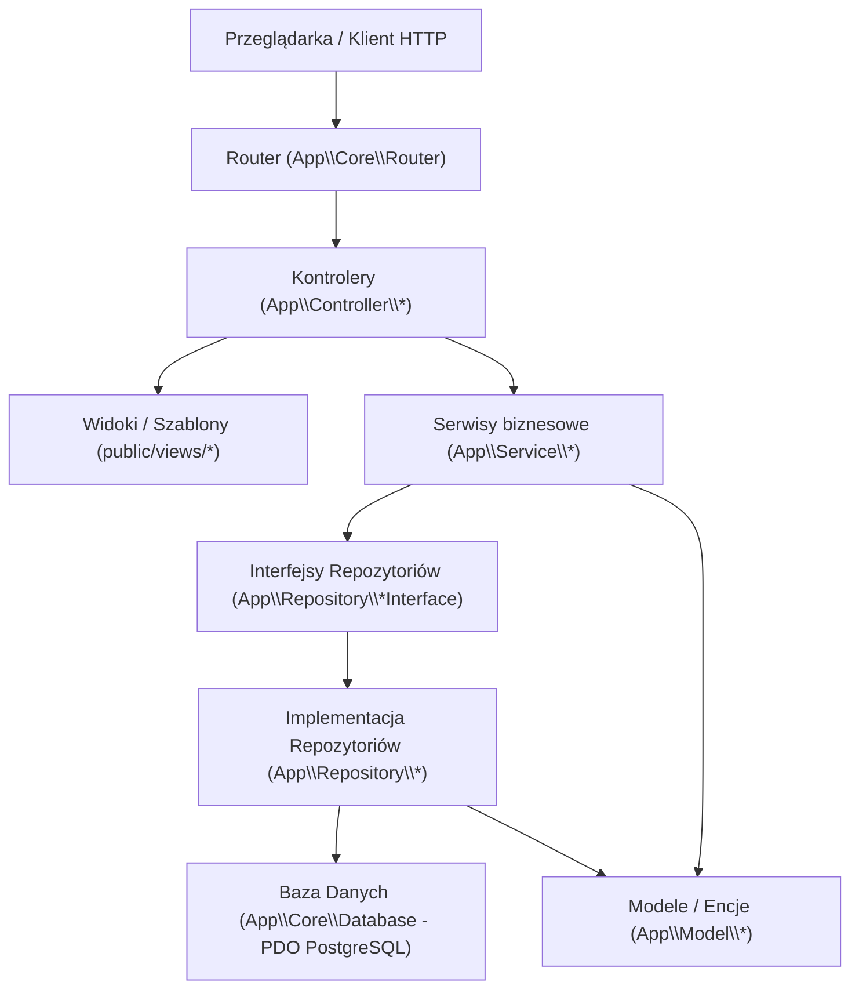
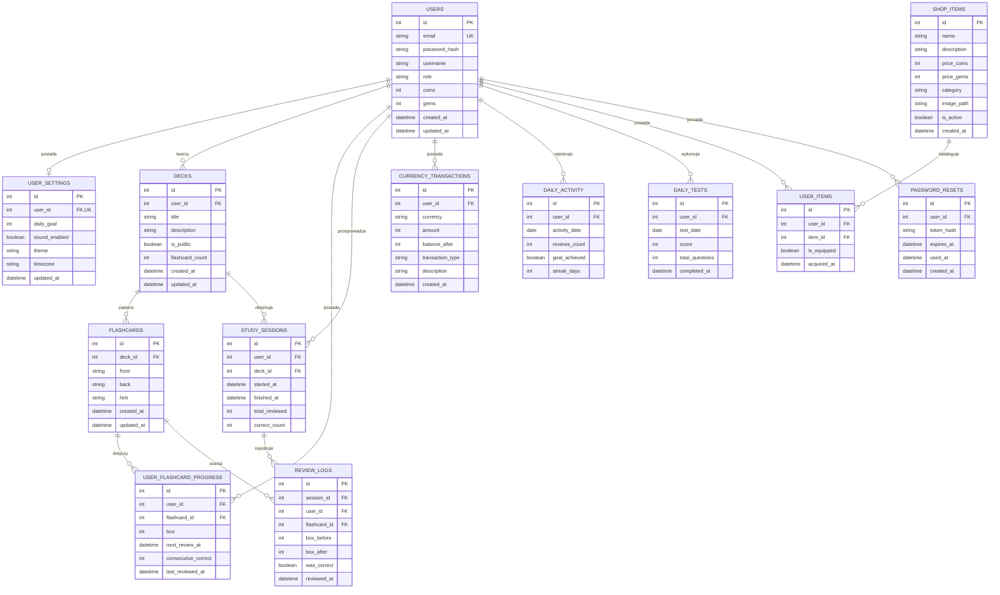

# Flashcards Leitner App (WDPAI)

Aplikacja webowa do nauki i powtórek fiszek oparta o **system Leitnera** z elementami grywalizacji (monety, klejnoty, serie nauki, sklep z nagrodami i ekwipunek).

---

## 1. Strategia gałęzi i Git Workflow

W projekcie stosowany jest uporządkowany przepływ pracy w oparciu o zadania Jira (projekt `KAN`):

### Gałęzie
- `main` — stabilna gałąź produkcyjna. Kod na `main` **musi być zawsze w stanie budowalnym** i przechodzić wszystkie testy.
- `develop` — gałąź integracyjna dla bieżącego rozwoju aplikacji.
- `feature/KAN-xx-opis` — gałęzie dedykowane dla poszczególnych zadań (np. `feature/KAN-22-git-workflow`, `feature/KAN-38-login`).

### Przepływ pracy (Workflow)
1. Utworzenie gałęzi `feature/KAN-xx-opis` z aktualnej gałęzi bazowej (`develop`).
2. Implementacja funkcjonalności z zachowaniem zasad obiektowości PHP 8.3 oraz separacji warstw.
3. Testowanie i weryfikacja poprawności kodu.
4. Wykonanie atomowych commitów powiązanych z zadaniem.
5. Pull Request (PR) i weryfikacja (code review / CI), a następnie merge do `develop` (i docelowo do `main`).

### Smart Commits i konwencja komunikatów commitów
Każdy commit musi być powiązany z numerem zadania z Jira:
```text
[KAN-xx] prefiks: krótki opis w trybie rozkazującym (po angielsku)
```
Dozwolone prefiksy:
- `feat` — nowa funkcjonalność
- `fix` — naprawa błędu
- `docs` — dokumentacja
- `refactor` — refaktoryzacja kodu (bez zmiany zachowania)
- `test` — testy jednostkowe / integracyjne
- `chore` — konfiguracja, narzędzia, zależności

Przykłady:
- `[KAN-22] docs: define branching strategy and commit convention`
- `[KAN-25] feat: rebuild router with regex params and http methods`
- `[KAN-38] feat: implement login endpoint and credential verification`

---

## 2. Architektura aplikacji i warstwy backendu

Aplikacja oparta jest o obiektową architekturę trójwarstwową (bez zewnętrznych frameworków full-stack). Każdy plik PHP posiada deklarację `declare(strict_types=1);` oraz pełne typowanie parametrów i zwracanych wartości. Zależności przepływają wyłącznie w dół:



### Zasady separacji warstw:
1. **Controller** — przyjmuje żądanie (`Request`), deleguje logikę do serwisów, zwraca obiekt `Response` (HTML/JSON/redirect). Zakaz zapytań SQL i kodu HTML w kontrolerach.
2. **Service** — realizuje logikę biznesową (np. algorytm Leitnera, logowanie, zakupy).
3. **Repository** — jedyna warstwa wykonująca zapytania SQL za pośrednictwem PDO prepared statements. Mapuje wiersze bazy na obiekty `Model`.
4. **Model/Entity** — silnie hermetyzowane obiekty domenowe i enumy.
5. **View** — szablony `*.html.php` z obowiązkowym escapowaniem zmiennych (`e()`).

---

## 3. Model danych i diagram ERD (Mermaid)

Model relacyjny bazy PostgreSQL 16 zaprojektowano w **trzeciej postaci normalnej (3NF)** z silnymi ograniczeniami integralności (klucze obce, unikalność, warunki `CHECK`).



### Ograniczenia i normalizacja (3NF):
- **Niezależny postęp Leitnera**: `user_flashcard_progress` posiada klucz unikalny `UNIQUE(user_id, flashcard_id)` — wielu użytkowników może uczyć się tej samej talii publicznej bez konfliktów postępu.
- **Audyt walut (monety/klejnoty)**: bieżące saldo w `users.coins` i `users.gems` jest chronione ograniczeniem `CHECK (coins >= 0 AND gems >= 0)`, a każda operacja jest rejestrowana w tabeli `currency_transactions` (księga transakcji z saldem po operacji).
- **Warunki CHECK**: `box BETWEEN 1 AND 5`, `daily_goal > 0`, `price_coins >= 0`, `price_gems >= 0`.
- **Kaskadowe usuwanie (ON DELETE)**: usunięcie talii usuwa jej fiszki i postęp (`CASCADE`), podczas gdy historia zakupów `user_items` zachowuje integralność (`RESTRICT`).

---

## 4. Zaawansowane mechanizmy bazy danych (PostgreSQL 16)

W projekcie wykorzystano zaawansowane mechanizmy silnika PostgreSQL:
1. **Widok statystyk `v_user_stats`**: agreguje w jednym zapytaniu informacje o postępach w pudełkach Leitnera (box 1-5), liczbie talii, ukończonych fiszek oraz passie dni (streak).
2. **Procedury i Triggery `update_updated_at_column`**: automatycznie aktualizują pole `updated_at` w tabelach `users`, `user_settings`, `decks` i `flashcards` przy każdej modyfikacji rekordu.
3. **Trigger denormalizacyjny `update_deck_flashcard_count`**: dynamicznie inkrementuje/dekrementuje liczbę `flashcard_count` w tabeli `decks` po dodaniu lub usunięciu fiszki, eliminując konieczność kosztownych zapytań `COUNT(*)` w listach talii.
4. **Funkcja SQL `leitner_interval(box)`**: funkcja wyliczająca interwał czasowy (`INTERVAL`) dla kolejnych pudełek systemu Leitnera (pudełko 1: 1 dzień, 2: 3 dni, 3: 7 dni, 4: 14 dni, 5: 30 dni).


